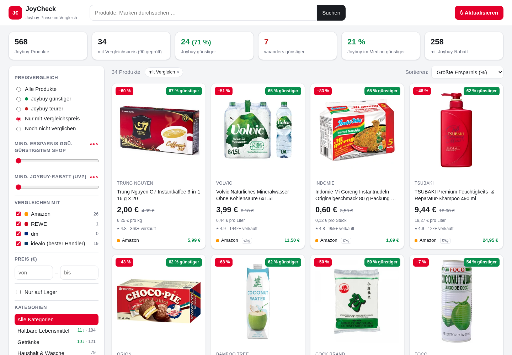

# JoyCheck – Joybuy-Preisvergleich

Ist [Joybuy.de](https://www.joybuy.de) (JD.com Europa) wirklich günstiger? **JoyCheck** crawlt Joybuy-Artikel,
sucht dieselben Produkte bei **Amazon, REWE, dm und idealo** und zeigt alles in einer Webshop-Oberfläche –
mit Filtern für „Joybuy günstiger“, Mindest-Ersparnis, Joybuy-Rabatt (UVP), Kategorie, Preis und Shop.



## Features

- **Webshop-UI**: Produktkacheln mit Bild, Preis, UVP-Rabatt, Grundpreis und den günstigsten Vergleichspreisen; Endlos-Scrollen
- **Filter**: Joybuy günstiger/teurer · Mindest-Ersparnis in % · Mindest-Joybuy-Rabatt · Kategorie · Crawl-Suchbegriff ·
  Preisbereich · nur auf Lager · Shop-Auswahl (Vergleich nur gegen ausgewählte Shops)
- **Sortierung**: größte Ersparnis (% / €), höchster Joybuy-Rabatt, Joybuy am teuersten, Preis, Bewertung, neu
- **Detailansicht**: Vergleichstabelle aller Shops mit Match-Qualität, EAN (REWE/dm), Links und Preisverlauf
- **Faire Vergleiche**: Packungsgrößen werden erkannt (`750 g`, `6 x 330 ml`, `3er Pack`, `60 Tabs` …). Bei abweichender
  Größe wird über den **Grundpreis** (€/kg, €/l, €/Stk) auf die Joybuy-Packung umgerechnet
- **Aktualisieren-Button** in der UI startet Crawl + Vergleich im Hintergrund (mit Fortschrittsanzeige)
- Preis-Historie in SQLite – bei jedem Lauf werden Änderungen protokolliert

## Installation

Voraussetzung: Python ≥ 3.12 und [uv](https://docs.astral.sh/uv/).

```bash
git clone https://github.com/hendkai/joybuy-compare.git
cd joybuy-compare
uv sync
uv run playwright install chromium
```

## Benutzung

```bash
# 1. Joybuy crawlen + Preise vergleichen (Standard-Suchbegriffsliste, 2 Seiten à 40 Artikel)
uv run jbc run

# eigene Suchbegriffe, max. 100 Vergleiche
uv run jbc run kaffee nutella "usb c kabel" --limit 100

# 2. Web-UI starten → http://127.0.0.1:8787
uv run jbc serve
```

Weitere Befehle:

| Befehl | Zweck |
|---|---|
| `jbc crawl [begriffe…] --pages N` | nur Joybuy-Artikel holen |
| `jbc compare --shops amazon,idealo --limit N --max-age H` | nur vergleichen (Artikel älter als H Stunden) |
| `jbc compare --sku 10135456 --max-age 0` | einen Artikel neu vergleichen |
| `jbc compare --known --max-age 20` | nur bereits verglichene Artikel auffrischen (Preis-Tracking) |
| `jbc rematch` | Matching auf gespeicherten Suchergebnissen neu berechnen – ohne erneutes Scraping |
| `jbc stats` | Kurzstatistik |
| `jbc unblock` | sichtbaren Browser öffnen, falls Joybuy ein Captcha zeigt – einmal lösen, danach läuft es headless weiter |
| `python -m joybuy_compare.debug_shop rewe "Nutella 750 g" 5.79 Nutella` | Matching für einen Shop debuggen |

### Konfiguration (Umgebungsvariablen)

| Variable | Default | Bedeutung |
|---|---|---|
| `JBC_DATA_DIR` | `~/.local/share/joybuy-compare` | Datenbank, Browserprofil, Logs |
| `JBC_ZIP` | `40213` | Postleitzahl für REWE (Preise sind marktabhängig) |
| `JBC_DOH` | `1` | DNS-over-HTTPS im Scraping-Browser – nötig, wenn ein Pi-hole/AdGuard Joybuy-Hosts blockt |
| `JBC_HEADLESS` | `1` | `0` = Browserfenster anzeigen |

### Täglich automatisch aktualisieren (systemd user timer)

```ini
# ~/.config/systemd/user/joycheck.service
[Service]
Type=oneshot
WorkingDirectory=%h/joybuy-compare
ExecStart=/usr/bin/uv run jbc run --pages 2

# ~/.config/systemd/user/joycheck.timer
[Timer]
OnCalendar=*-*-* 06:30
Persistent=true
[Install]
WantedBy=timers.target
```

`systemctl --user enable --now joycheck.timer`

## Wie es funktioniert

```
joybuy_compare/
├── sources/joybuy.py   Joybuy-Suche (Next.js) → fängt die guide_search_getItems-JSON-Antworten der echten Seite ab
├── sources/shops.py    Amazon / REWE / dm / idealo Scraper (Playwright, DOM bzw. abgefangene JSON-APIs)
├── units.py            Preise, Packungsgrößen, Grundpreise parsen
├── matching.py         Fuzzy-Matching (Marke, Wortabdeckung, Modellnummern, Packungsgröße)
├── crawler.py          Orchestrierung, Throttling pro Shop, Status-Datei für die UI
├── db.py               SQLite (Produkte, Angebote, Suchen, Preisverlauf)
├── server.py           FastAPI-JSON-API
└── static/             Webshop-Frontend (Vanilla JS, kein Build-Schritt)
```

- Joybuy liefert **keine EAN**, daher wird über Titel gematcht: Marke muss vorkommen, Modellnummern (z. B. `WH-1000XM5`)
  müssen übereinstimmen, die Wortabdeckung muss passen. Gleiche Packungsgröße wird bevorzugt, sonst Grundpreis-Vergleich.
- REWE und dm werden nur für Artikel mit Gewichts-/Volumenangabe abgefragt (Lebensmittel/Drogerie).
- idealo liefert den günstigsten Händlerpreis („ab …“, ohne Versand). Angebote, die idealo von Joybuy selbst listet
  („Verkauf durch: joybuy.de“), werden verworfen.
- Varianten müssen übereinstimmen (Zero/Light/Bio/Vegan/Vollkorn/Laktosefrei …), ebenso die Produktwörter jenseits der
  Marke („Spaghetti“ ≠ „Fusilli“). Preisunterschiede > Faktor 3,3 gelten als Fehl-Match.
- Ein echter Chromium (Playwright, „new headless“) wird verwendet, da alle Shops Bot-Schutz haben. Zwischen Anfragen an
  denselben Shop wird gedrosselt. Blockt ein Shop (Captcha), wird er für den restlichen Lauf übersprungen.

## Hinweise

- Inoffizielles Hobby-Projekt, nicht mit Joybuy, JD.com, Amazon, REWE, dm oder idealo verbunden.
  Bitte die Nutzungsbedingungen der Shops beachten und moderat crawlen (z. B. 1× täglich).
- Matching ist heuristisch – die Detailansicht zeigt Match-Art und -Score, damit man Ausreißer erkennt.
- Preise ohne Versandkosten; Joybuy-Preise können vom Login/Neukunden-Gutscheinen abweichen.

## Lizenz

MIT
